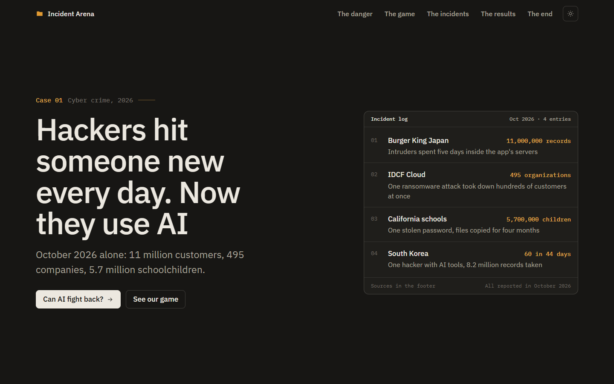
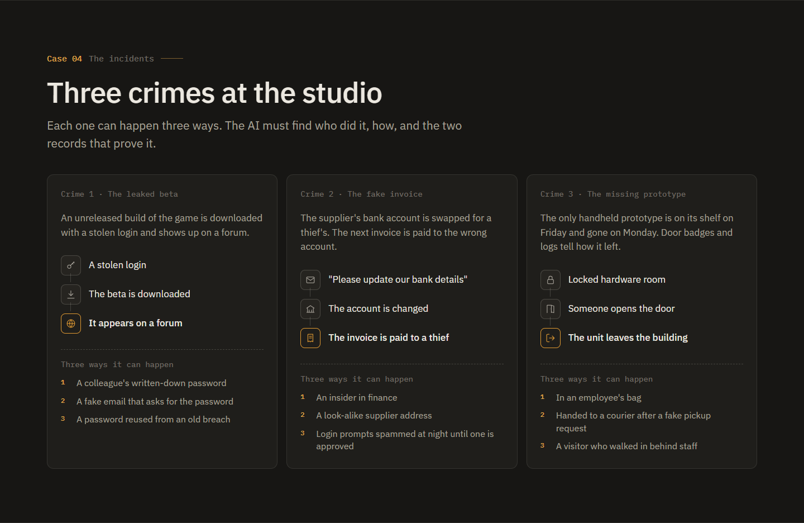

# Incident Arena

**Hackers hit someone new every day. Now they use AI. Can AI fight back?**

We built a hacking case for AIs to solve. A big AI practises on it and writes a playbook, and then two small, cheap
AIs use that playbook to solve cases they have never seen.

## The danger

October 2026 alone: 11 million Burger King Japan customer records, 495 organisations taken down at once through IDCF
Cloud, 5.7 million California schoolchildren, and one hacker in South Korea who used AI tools to break into 60
organisations in 44 days. Attacks per organisation rose 48% in a year (Check Point Research), and 84% of surveyed
ransomware victims were hit by attackers who used AI (Semperis).

AI helps the hackers. It can help the defenders too.

## Our project

A fake game studio, *Pixelforge*, on a fake computer. A crime has happened. The AI must find **who did it, how, and the
two records that prove it**, using only screenshots, a mouse and 60 clicks.

1. **A big AI practises.** Opus, Sonnet and Sol each play 20 practice cases.
2. **It writes the playbook.** One chapter per crime, general lessons only: no names and no answers.
3. **Small AIs get the playbook and play.** Claude Haiku 5.5 and GPT-6-Luna play 55 new cases, alone and with the
   playbook.
4. **Every game is checked.** Only the game's own clicks count. A game that breaks the rules is replayed, never counted.

## The incidents

Three crimes at the studio. Each one can happen three ways.

| Crime | What happens | Three ways it can happen |
|---|---|---|
| **1 · The leaked beta** | An unreleased build is downloaded with a stolen login and shows up on a forum. | a colleague's written-down password · a fake email that asks for the password · a password reused from an old breach |
| **2 · The fake invoice** | The supplier's bank account is swapped for a thief's, and the next invoice is paid to the wrong account. | an insider in finance · a look-alike supplier address · login prompts spammed at night until one is approved |
| **3 · The missing prototype** | The only handheld prototype is on its shelf on Friday and gone on Monday. | in an employee's bag · handed to a courier after a fake pickup request · a visitor who walked in behind staff |

## The results

**With the playbook, both small AIs solved far more cases.** The test used 55 new cases, mixed from the three crimes.
The playbook has a chapter per crime. The AI is told only "an incident at Pixelforge" and must pick the right chapter
itself.

| 55 mixed cases | With the playbook | Alone |
|---|---|---|
| **Claude Haiku 5.5** · cases solved | **51 of 55** | 13 of 55 |
| per game | $0.093 · 3.6 min | $0.085 · 3.8 min |
| per solved case | **$0.10** | $0.36 |
| **GPT-6-Luna** · cases solved | **38 of 55** | 9 of 55 |
| per game | $0.050 · 4.8 min | $0.049 · 4.5 min |
| per solved case | **$0.07** | $0.30 |

**Crime by crime**, 55 cases per crime:

| Solved of 55 | Alone | Its chapter only (told the crime) | Whole playbook (not told) |
|---|---|---|---|
| Haiku · Leak | 8 | 40 | **45** |
| Haiku · Invoice | 15 | 55 | **51** |
| Haiku · Prototype | 26 | 39 | **54** |
| Luna · Leak | 5 | 29 | **28** |
| Luna · Invoice | 12 | 49 | **48** |
| Luna · Prototype | 14 | 48 | **50** |

Given just its crime's chapter, and told the crime, the AI improves every time. Given the whole playbook and not told the
crime, it does about as well.

- **The fake playbook:** one of the same length but with no useful lessons was always tested too, and it barely helped.
- **Lessons do not travel:** a chapter reused on a different crime, or one merged "general" book, did not help. The
  general book even made Haiku worse on the prototype (26 → 11).
- **An unexplained result:** Haiku scored higher on the prototype with the whole playbook than with its chapter alone.
  We cannot explain that, so it is not a claim.

## Guard duty · a side test

Can a playbook stop scams *before* they happen? Each day, 8 requests arrive and some are scams. The player must stop
every scam without blocking real work. A day is safe only if all 8 decisions are right.

| Safe days of 55 | Alone | Playbook | Fake book |
|---|---|---|---|
| Haiku 5.5 | 43 | **55** | 39 |
| GPT-6-Luna | 51 | 54 | 49 |

- **Haiku: a clear win.** Alone, it kept blocking real work. With the playbook, it was safe on every day.
- **Luna** was already safe alone, so there was little left to gain.

By the rule set before the test, the verdict is "half": Haiku passed, but Luna's gain is too small to count.

## Case closed

**A big AI can teach small AIs to catch hackers.** On mixed cases Haiku went from 13 to 51 solved and Luna from 9 to
38. On guard duty Haiku reached 55 safe days out of 55.

**Still open:** each chapter teaches one game's three ways a crime can happen, and real incidents vary far more. The
test used two small models and 55 cases per test. The effects are large, but they are not proof about AI in general.

---

## Look around

| Folder | Contents |
|---|---|
| [`game/`](game/) | the browser game: levels, random cases, case generators |
| [`arena/`](arena/) | the scripts that make AIs play and measure them, plus the playbooks |
| [`results/`](results/) | the website |
| [`docs/`](docs/) | the design notes, with every result and its statistics |

- **The website:** [`results/index.html`](results/index.html) is the story above with charts. Every game is listed in
  `results/games.html`, and the statistics are in `results/details.html`.
- **Play it yourself:** [`game/index.html`](game/index.html) has the hand-made levels. `game/case.html`,
  `case2.html`, `case3.html` and `case-guard.html` give random cases. Everything runs in the browser, with no install.
- **The playbooks:**
  - `arena/playbook-frozen-*.md`: crime 1, one per teacher
  - `arena/invoice-books/`, `arena/proto-books/`, `arena/guard-books/`: the other chapters and books
  - `arena/library-books/`: the whole playbook
  - `arena/general-books/`: the general book and its fake
- **Every decision and every result, with p-values:** [`docs/`](docs/). Start with
  [`docs/DESIGN-exp3.md`](docs/DESIGN-exp3.md).

## How a test works

1. **Fair cases.** Each crime has a seeded generator (`game/cases/gen*.js`), a reference solver and a fairness checker.
   The checker makes sure the answer cannot be guessed from surface clues such as wording, length, position or timing.
   An outside model (GPT-6.1-Sol) reviewed the generators for leaks.
2. **Practice.** The teacher plays 20 practice cases. After each one, a separate call with no tools rewrites the
   playbook from a short debrief. A filter rejects any book that contains names, addresses, times or answers. The book
   is then frozen, with its content hash in the filename.
3. **Test.** Haiku and Luna play in a headless browser (`arena/server*.py`), using only `look`, `click`, `type` and
   `scroll` through a controller. Every transcript is audited (`arena/audit.py`).
4. **Verdict.** An exact one-sided paired sign test. The playbook must beat both "alone" and the fake book for **both**
   models at p ≤ 0.025, and a "Yes" also needs at least 9 extra solved cases.

The models ran through ordinary subscriptions (the Claude Code and Codex CLIs). API costs are estimates. Game
transcripts are kept outside this repository. The studio and every case are made up; no real system was touched.

---

Made by Yentl Peck, directing AI agents: Claude Opus and Fable built the game, the tests and the website, and
GPT-6.1-Sol reviewed them.
