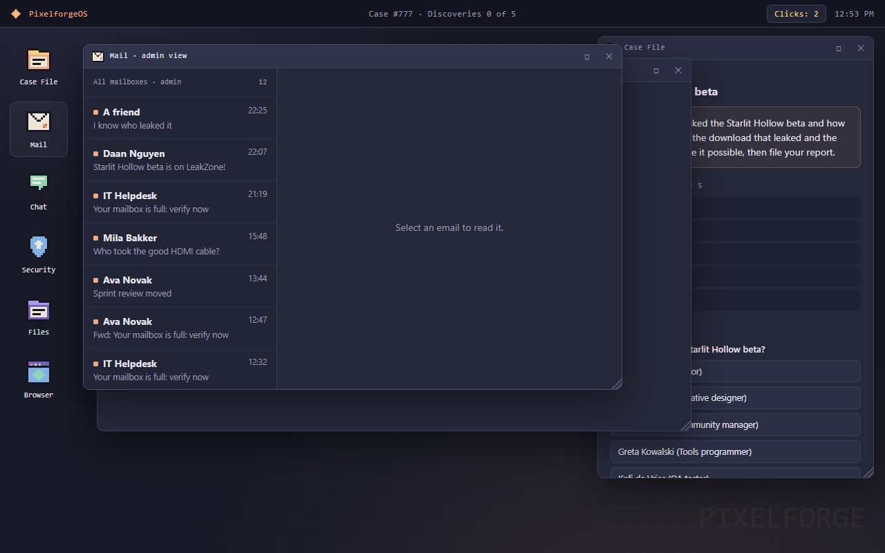

# Incident Arena

**Can a big AI write a playbook that makes small, cheap AIs better at security investigations?**

Incident Arena is a browser game set at *Pixelforge*, a fictional game studio. Something has gone wrong: a game build
leaked, a supplier payment went to the wrong bank account, a prototype disappeared from a locked room. The player
reads mail, chat, logs and badge records on a fake office computer and files a report: **who did it, how, and two
pieces of evidence that prove it.**

The same game is played by AI models, using screenshots only. A big model (Claude Opus) practises and writes a
playbook. Then two small models, **Claude Haiku 5.5** and **GPT-6-Luna**, play 55 fresh cases each, with and without
that playbook.

## The results

Every number below is *cases solved out of 55*. Each test compares paired cases (the same case with and without the
book). It always includes a **fake playbook** of the same length with no useful lessons, and the verdict rule was fixed
before the first test game.

| | Alone | Fake book | **Book for this crime** | Book from another crime, or one "general" book |
|---|---|---|---|---|
| Crime 1 · The leaked beta | Haiku 8 · Luna 5 | 12 · 3 | **40 · 29** | — |
| Crime 2 · The fake invoice | 15 · 12 | 16 · 16 | **55 · 49** | crime 1's book: 16 · 16 |
| Crime 3 · The missing prototype | 26 · 14 | 26 · 14 | **39 · 48** | general book: **11** · 20 |

**The library.** One book with a chapter per crime. The AI is *not told* which crime it is: the prompt only says
"You are investigating an incident at Pixelforge", so it has to read the case and pick the right chapter itself.

| | Alone | Own book | **Library** |
|---|---|---|---|
| Haiku · leak / invoice / prototype | 8 / 15 / 26 | 40 / 55 / 39 | **45 / 51 / 54** |
| Luna · leak / invoice / prototype | 5 / 12 / 14 | 29 / 49 / 48 | **28 / 48 / 50** |

On 55 cases mixed across the three crimes, with the same neutral prompt: Haiku went from 13 to **51** and Luna from 9
to **38**.

### What we learned

1. **A playbook written for one kind of crime works**, often dramatically. Crime 2 went from 15 to 55 for Haiku.
2. **Lessons do not travel.** A book reused on another crime did no better than the fake one, and one merged
   "general" book made Haiku *worse* (26 → 11). It still found the right person, but it chose the wrong proof.
3. **A library of specialised chapters works about as well as separate books**, even when the AI has to work out the
   crime itself.
4. **It is cheaper too.** On crime 1 the cost per solved case dropped from $0.51 to $0.18 (Haiku) and from $0.61 to
   $0.12 (Luna).

**Guard duty**, a prevention mode in which the player stops scams *before* clicking: the book gave Haiku 55 of 55 safe
days, against 43 alone. Luna was already safe on 51 days alone, so the pre-registered verdict is "Not yet".

### Honest limits

- Each crime comes from one case generator. The playbooks learn how *this game's* crimes work, and real incidents vary
  far more.
- Two small models, 55 cases per test. The effects are large, but this is not proof about AI in general.
- In the library test, Haiku did better on crime 3 with the library (54) than with its own book (39). We cannot
  explain that, so it is not a claim.

## Look around

- **Results website:** open [`results/index.html`](results/index.html). It is the whole story with charts. All games
  are in `results/games.html` and the technical details in `results/details.html`.
- **Play it yourself:** open [`index.html`](index.html) for the hand-made levels, or `case.html`, `case2.html`,
  `case3.html` and `case-guard.html` for random cases. Everything runs in the browser, with no install.
- **Every decision and every result, with p-values:** [`DESIGN-exp3.md`](DESIGN-exp3.md),
  [`cases/DESIGN-family2.md`](cases/DESIGN-family2.md), [`cases/DESIGN-family3.md`](cases/DESIGN-family3.md) and
  [`cases/DESIGN-guard.md`](cases/DESIGN-guard.md).
- **The playbooks themselves:**
  - `arena/playbook-frozen-*.md` (crime 1, one per teacher)
  - `arena/invoice-books/`, `arena/proto-books/` and `arena/guard-books/` (specialised books)
  - `arena/general-books/` (the general book and its fake)
  - `arena/library-books/` (the library)

## How a test works

1. **Fair cases.** Each crime has a seeded generator (`cases/gen*.js`), a reference solver and a fairness checker. The
   checker makes sure the answer cannot be guessed from surface clues such as wording, length, position or timing.
   An outside model (GPT-6.1-Sol) reviewed the generators for leaks.
2. **Practice.** The teacher (Opus) plays 20 practice cases. After each one, a separate call with no tools rewrites the
   playbook from a short debrief. A filter rejects any book that contains names, addresses, times or answers. Then the
   book is frozen, and its hash is in its filename.
3. **Test.** Haiku and Luna play the 55 test cases in a headless browser (`arena/server*.py`). They may only run
   `look`, `click`, `type` and `scroll` commands through a controller, with a budget of 60 commands. Every transcript
   is audited (`arena/audit.py`), and a game that breaks the rules is replayed, never counted.
4. **Verdict.** An exact one-sided paired sign test. The book must beat both "alone" and the fake book for **both**
   models at p ≤ 0.025, and a "Yes" also needs at least 9 extra solved cases.

The models ran through ordinary subscriptions (Claude Code and Codex CLIs), not the API. Game transcripts live outside
this repository.

---

Built in November 2026 by Yentl, directing AI agents: Claude Opus and Fable built the game, the tests and the website,
and GPT-6.1-Sol reviewed them.
