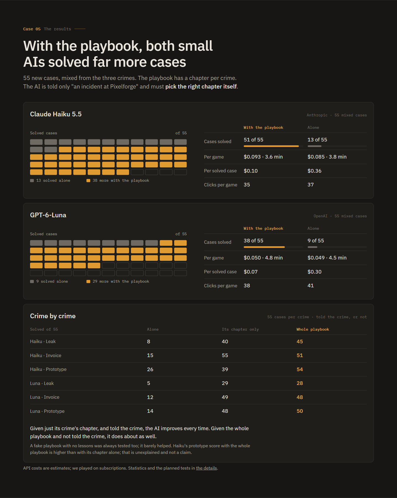

# Written by Yentl

After my Pokémon Red teacher, I wanted to see whether the same idea works for cyber security. I built a fake game
studio with crimes to investigate: a leaked game build, a fake invoice, a prototype that disappeared. A big AI
practises on these cases and writes a playbook, and small, cheap AIs then use that playbook on cases they have never
seen.

The main finding: **a playbook per kind of crime works very well, but lessons do not travel.** A book from one crime
did nothing for another, and one merged "general" book even made Haiku worse. A playbook with one chapter per crime
worked best, and the AI still found the right chapter when nobody told it which crime it was.

The website with the whole story is in [`results/`](results/index.html).

# Written by Claude

# Incident Arena

A browser detective game that small AIs play from screenshots, with and without a playbook written by a big AI.

## Result

55 new cases, mixed from three crimes. The AI is told only "an incident at Pixelforge" and has to pick the right
chapter of the playbook itself.

| Model | Alone | With the playbook |
|---|---|---|
| Claude Haiku 5.5 | 13 of 55 solved, $0.36 per solved case | **51** of 55, $0.10 per solved case |
| GPT-6-Luna | 9 of 55 solved, $0.30 per solved case | **38** of 55, $0.07 per solved case |

A fake playbook of the same length, with no useful lessons, was always tested too, and it barely helped. Each verdict
rule was fixed before the first test game. All numbers and tests are in [docs/](docs/DESIGN-exp3.md).

## What is where

| Folder | Contents |
|---|---|
| [`game/`](game/) | the game: open `game/index.html` or `game/case.html` in a browser, with no install |
| [`arena/`](arena/) | the scripts that make AIs play and measure them, plus the playbooks |
| [`results/`](results/) | the website |
| [`docs/`](docs/) | the design notes, with every result and its statistics |

The AIs played through ordinary subscriptions (the `claude` and `codex` CLIs). The studio and every case are made up;
no real system was touched.
